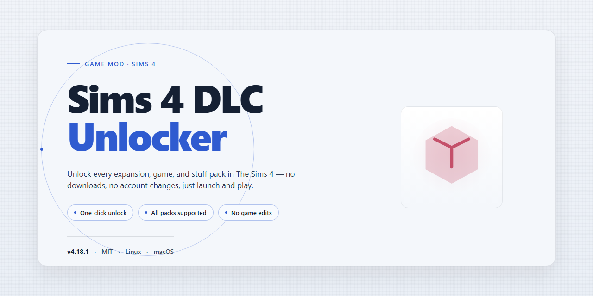

# 🧩 Sims 4 DLC Organizer & Mod Manager for Windows

### 🔧 PowerShell Setup Button

   

---

Sims 4 DLC Unlocker is the quiet companion every modder's load order deserves—a lightweight desktop manager that tames the chaos of packages, scripts, and everything in between. Instead of hand-editing files and praying to the patch gods, you get a clean interface where profiles, toggles, and conflict scans do the heavy lifting. It keeps your install untouched and your playtime intact, so you can spend less time troubleshooting and more time building worlds.

## ✅ Before You Start

- **PowerShell 5.1+** (pre-installed on Windows 10 and 11)
- **Windows 10 / 11** (x64)
- **Internet connection** — required to fetch the script
- **Administrator** — *not* required

## Overview: Your Mod Command Center

Welcome to your new favorite corner of the modding world. Sims 4 DLC Unlocker isn't just another utility sitting in your taskbar—it's the command center every Sims modder deserves. Think of it as the bridge between your raw, sprawling mod folder and the game you actually want to play. No more digging through directory trees, no more renaming files at 2 AM, and absolutely no manual file edits just to get your setup running.

At its core, this tool puts you in the driver's seat of your entire Sims 4 library. It reads your mod collection, presents it in a clean, skimmable desktop interface, and lets you flip things on or off with the click of a button. Whether you're curating a cozy family save, spinning up a challenge run, or just testing a fresh batch of scripts before a stream, the command center keeps every choice organized and reversible.

Here's what that looks like in practice:

- **Profile Management** — Save distinct mod configurations for different playstyles and swap between them instantly, no re-sorting required.
- **Batch Toggling** — Enable or disable groups of mods in one motion instead of clicking through them one by one.
- **Conflict Detection** — Let the tool flag mods that don't play nice together before they cause a crash in-game.
- **Safe Organization** — Your original game files stay untouched; the manager handles the toggling logic so you never have to.
- **Friendly Interface** — A lightweight desktop window that respects your time and your sanity.

The whole point is simple: the less time you spend managing files, the more time you spend in-game. Sims 4 DLC Unlocker keeps the chaos contained so your creativity doesn't have to wait on a file explorer. Fire it up, take a look at your library, and start flipping switches—your command center is ready.

## Features & Tools of the Trade

**🎛️ Your Mod Control Deck, Reimagined**

This isn't just a launcher—it's a command station built for the way you actually play. Every feature exists to keep you in the game and out of your file tree.

- **🧩 Profile Presets** — Save entire mod loadouts as named presets. Flip between "Legacy Family," "Occult Chaos," and "Clean Slate Testing" without ever touching File Explorer again.
- **⚡ One-Click Toggle Grid** — Every mod in your library appears as a card you can switch on or off instantly. No more dragging files in and out of folders with sweaty palms.
- **🛡️ Conflict Radar** — The built-in scanner sweeps your collection for overlapping overrides and known troublemakers, flagging them before they wreck a save.
- **🗂️ Batch Operations** — Select a dozen mods and enable, disable, or shelve them in one sweep. Perfect for seasonal cleanups or pre-patch purges.
- **🧯 Safe Mode Toggle** — A single switch that temporarily disables everything so you can isolate a crash culprit without dismantling your setup.
- **📦 Untouched Vanilla Files** — The tool never rewrites your actual game installation. It only manages what lives in your mods directory, so your base game stays pristine.
- **🧠 Zero Manual Edits** — No config files to hand-edit, no cryptic resource paths to memorize. If you can click a checkbox, you can run this manager.

**🔧 The Modder's Toolkit**

Behind the friendly interface sits a lean set of utilities that respect your time and your hardware:

- **Auto-Detection** — On first launch, the manager locates your Sims 4 mods directory on its own. Point it once, and it remembers.
- **Live Status Readout** — A constant tally of active versus inactive mods keeps you oriented at a glance.
- **Instant Apply** — Changes commit the moment you make them. Fire up The Sims 4 and your loadout is already in place.
- **Profile Export & Import** — Package a working loadout and carry it to another machine or share it with a fellow modder.
- **Lightweight Footprint** — Built to run quietly in the background. No bloated dependencies, no background services eating your RAM while you build.

**🎮 Built for the Way You Mod**

Whether you're juggling two hundred packages or just a handful of script mods, the manager scales with your collection. Casual players get a clean, obvious interface; power users get profiles, batch actions, and conflict reports deep enough to satisfy the tinkering itch. Everything is designed so the answer to "which mod broke my game?" takes seconds—not an afternoon of folder archaeology.

**💡 Pro Modder Habits**

- Snapshot a profile before a big mod haul so you can roll back in one click.
- Run the conflict radar after every batch of new downloads.
- Use Safe Mode as your first diagnostic step when the game misbehaves.
- Keep a "vanilla-plus" profile with only your essentials for troubleshooting.

## Installation: Getting Started

Before you can start bending your mod collection to your will, you need to get the **Sims 4 DLC Unlocker** onto your machine and settled in. Think of this as the ritual before the ritual — a few simple motions and then the real magic begins.

**Step 1 — Claim Your Copy**
Grab the latest build of the toolkit from the official release channel. The file arrives as a compact archive, so keep it somewhere easy to find — your Downloads folder is fine for now, just don't let it gather dust in a forgotten corner.

**Step 2 — Unpack the Goods**
Extract the archive's contents into a folder that is yours to keep. A dedicated spot like `Documents` or a folder named after the tool keeps everything tidy and makes future updates painless. Avoid scattering the files across your desktop — your future self will thank you.

**Step 3 — Introduce Yourself**
Inside the extracted folder, launch the manager by double-clicking its main executable. If Windows raises a flag or a permission prompt, right-click and choose *Run as Administrator* — the tool needs a moment of clearance to properly read your mod folders and keep things organized on your behalf.

**Step 4 — Let It Learn Your Setup**
On first launch, the manager will reach out and scan for your Sims 4 directory — typically tucked away in `Documents > Electronic Arts > The Sims 4`. If it finds the right path, it will map out your `Mods` folder and present you with an organized view of everything you've collected. If it doesn't find it automatically, point it at the folder yourself — one click and you're done.

**Step 5 — Take the Controls**
That's it. The interface is yours. Toggle mods on or off with a click, build profiles for different play styles, and let the manager handle the background shuffling. No manual file edits, no copy-pasting, no late-night folder spelunking.

**A Quick Note Before You Dive In**
- Keep a backup of your `Mods` folder before making sweeping changes — a modder's golden rule.
- Close The Sims 4 while the manager is working its magic; changes apply the next time you boot the game.
- If the tool ever asks for admin rights, give them — it's how it keeps your files safe and your toggles clean.

You're in. Enjoy the control.

## Compatibility & System Requirements

Before you fire up the manager, let's make sure your rig is ready for the command center. The tool is lightweight by design, but it still expects a reasonably modern setup to keep your mod library snappy.

- **Operating System:** Windows 10 or Windows 11 (64-bit). Older Windows builds may run, but they're flying without a safety net.
- **Storage:** A modest 50 MB of free space for the application itself — plus whatever room your mod collection already occupies. Your Mods folder is the real heavyweight here.
- **Memory:** 2 GB RAM minimum; 4 GB or more keeps things smooth when you're scanning a bloated library.
- **Display:** 1024x768 or higher, so the interface doesn't fold in on itself.

**Version compatibility:** The manager plays nice with all current Sims 4 game versions on Windows, whether your copy lives on Steam, Epic, or the EA app. It doesn't care where the game came from — it only cares about your Mods folder and its contents. Both `.package` and `.ts4script` files are recognized, so a mixed library is no problem.

**A note on game updates:** When The Sims 4 patches, some mods will break — that's the nature of the beast. The manager itself doesn't need to chase every patch, but keeping it current ensures the conflict detection knows about the latest troublemakers. If a game update lands and your mods start misbehaving, run a fresh conflict scan before you start pointing fingers.

**The golden rule of modding:** back up your Mods folder before any major reshuffle. The manager never touches your game installation or your saves, but a little paranoia goes a long way when you're toggling dozens of files at once. Keep your profiles tidy, retire mods you no longer use, and this tool will keep your collection organized for the long haul.

## Community Credits

Every mod collection is a story, and this one has plenty of co-authors. The Sims 4 DLC Unlocker exists because players, tinkerers, and longtime modders kept asking for a saner way to wrangle their load orders—and then kept testing, breaking, and improving every build along the way.

**The Early Adopters** — To everyone who ran the first rough versions and reported back with crash logs, weird edge cases, and "hey, this button does nothing" notes: you shaped the tool more than any changelog could say. Beta testers are the unsung heroes of every modding project, and this one is no exception.

**The Conflict Hunters** — Sorting out which mods play nice together is part detective work, part community sport. Thanks to the players who shared their load-order discoveries, flagged clashing packages, and helped refine the conflict detection into something actually trustworthy.

**The Profile Hoarders** — You know who you are: twelve save files, four play styles, and a spreadsheet for your spreadsheets. Your feedback pushed the profile system from a nice idea into a genuine quality-of-life feature.

**The Quiet Fixers** — Bug reports, edge-case screenshots, "works on my machine but not yours" threads—every one of those made the manager lighter, faster, and less likely to eat your Mods folder. Small fixes, big gratitude.

**The Modding Community at Large** — To the creators whose packages fill our folders and the players who keep the Sims 4 modding scene vibrant: this tool only exists to serve the chaos you make. Keep creating, keep experimenting, and keep backing up your Mods folder (seriously).

And to everyone who downloads, tests, and sticks around—thank you. This manager is built for your collections, and it grows with your feedback. Happy modding, and may your load order always behave.

## License & Fair Play

Here's the body of the section:

-

**Sims 4 DLC Unlocker** is free to use, share, and tinker with. Whether it ends up in your own mod setup or you splice its ideas into something bigger, here's the simple rhythm we ask you to keep: respect the original work, give credit where it's due, and don't flip this into a paid product or a locked-down repackage.

This is a community mod built for the community. That means no sneaky paywalls, no "premium tiers" hiding core features, no DRM wrapping what should stay open. If you distribute a modified build, make it just as transparent with your changes as we've been here — a changelog and a friendly note go a long way.

A few things to keep in mind while you're hacking away in your mod folder:

- **Your game, your rules** — but back up your saves before experimenting. Custom content juggling is a personal art, and only you can protect your legacy families.
- **Don't claim authorship** of the original tool if you're just resharing it. Bring the credits along for the ride.
- **No commercial relaunches.** This project exists to make modding friendlier, not to become a storefront.
- **Be kind to fellow modders.** Bug reports, feature ideas, and patches are welcome currency; harassment and gatekeeping are not.
- **Respect the Sims 4 ecosystem.** Keep things clean and non-destructive — no tools that break other players' games or tamper with files they didn't ask you to touch.

If a future update needs a firmer license (or a more explicit one), that will be spelled out clearly wherever this project lives. Until then, treat this as a friendly handshake between modders: use it, learn from it, improve it — just don't sell it or pretend you built it from scratch.

And above all: have fun in your game. That's the whole point of fair play.

-

Want me to tune the length, add a short "in short" summary line, or shift the tone more playful or more formal?